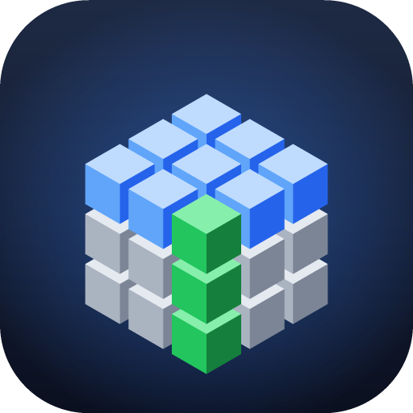

<p align="center"></p>

<h1 align="center">Agent Cubes</h1>

<p align="center">Eine Live-Würfel-Zeitleiste der Arbeit deiner Agents, direkt neben dem Claude-Code-Chat.<br>
<a href="README.md">English version</a></p>



Jeder Schritt im Plan der Agents (`update_plan`, `TodoWrite`, `TaskCreate`/`TaskUpdate`) wird ein Glaswürfel auf
einer Zeitleiste. Solange an einem Schritt gearbeitet wird, füllt sich sein Würfel mit kleinen Würfeln. Jeder steht
für einen Abschnitt der echten Tool-Aufrufe des Schritts und ist nach Art der Arbeit eingefärbt: Lesen, Schreiben,
Ausführen, Agents. Ein fertiger Schritt wird ein massiver Würfel mit Haken.

Subagents erscheinen als farbige Marker auf dem Würfel, an dem sie arbeiten. Das Panel schätzt Fortschritt und
Restzeit, erkennt hängende Schritte, zeigt, wie voll das Kontextfenster ist, und gibt es in sechs Skins.

## Funktionen

- **Würfel-Zeitleiste** mit Status je Schritt: offen, läuft, erledigt, wartet auf dich, Fehler, dazu ein Symbol je
  Status, damit die Farbe nie das einzige Merkmal ist
- **Agents**: Hauptagent und Subagents mit aktuellem Werkzeug und Würfel; **Ansehen** springt zum Verlauf des Agents
- **Fortschritt und Restzeit**, gelernt je Art des Schritts (Tests, Review, Recherche, Doku, Setup, Ausliefern,
  sonstige Arbeit) aus dem aktuellen und aus früheren Aufträgen
- **Hängt-Erkennung**: Fehler in Folge, immer derselbe Aufruf, lange Stille oder deutlich langsamer als üblich
- **Kontext-Tank** am Sockel: gelb ab 70 %, rot ab 85 %
- **Würfel-Details**: Dauer, Tokens, Kostenanteil, geänderte Zeilen, Testläufe, Dateien und letzte Aufrufe eines Schritts
- **Abhängigkeiten** zwischen Aufgaben als Leitungen mit Schloss am wartenden Würfel
- **Wartezeit**: wie lange die Agents auf dich gewartet haben, live und je Auftrag
- **Zeitstrahl**: eine Spur je Agent, wann er gearbeitet hat, Wartephasen in Gelb
- **Zusammenfassung** am Ende eines Auftrags, mit einem Klick als Markdown kopiert
- **Kostenbudget** pro Auftrag mit Warnung
- **Statistik** über deine letzten zwölf Aufträge, **Daten-Export** als CSV und JSON
- **Tasten 1–9** öffnen die Details der ersten neun Würfel
- **Kompaktmodus** für lange Pläne, **Standbild** ohne Animation, **Export** der Zeitleiste als SVG-Datei
- Oberfläche auf **Deutsch und Englisch**

## Skins

| Klassisch | Cyber | Stellar |
| --- | --- | --- |
|  |  |  |
| **Retro** | **Steampunk** | **Minimal** |
|  |  |  |

Den Skin wählst du im Dropdown oben im Panel.

## Installation

Im Terminal, an der Eingabe einer Claude-Code-Sitzung:

```
/plugin install agent-cubes --marketplace thatkidluke/agent-cubes
```

Bestätige das Hinzufügen des Marketplace mit `y` und wähle dann den Geltungsbereich.

Oder direkt in der Shell:

```
claude plugin install agent-cubes --marketplace thatkidluke/agent-cubes
```

In der Desktop-App: Klicke auf **+** neben dem Eingabefeld, dann auf **Plugins**, wähle **Add marketplace** und gib
`thatkidluke/agent-cubes` ein, danach **Add plugin** bei Agent Cubes.

Das Panel öffnet sich beim Sitzungsstart (abschaltbar) oder jederzeit mit `/cubes`.

## Einstellungen

Die Einstellungen stehen im Konfigurationsmenü unter Agent Cubes; eine Änderung lädt das Plugin sofort neu.

| Einstellung          | Typ     | Standard  | Bedeutung |
| -------------------- | ------- | --------- | --------- |
| `language`           | Auswahl | `de`      | Sprache des Panels: `de` oder `en`. |
| `budgetUsd`          | Zahl    | 0         | Kostenbudget pro Auftrag in USD; gelb ab 80 %, Hinweis bei Überschreitung. 0 schaltet es ab. |
| `defaultSkin`        | Auswahl | `classic` | Skin, solange im Panel keiner gewählt ist. Eine Wahl im Panel hat Vorrang. |
| `autoOpen`           | Ja/Nein | ja        | Panel beim Start jeder Sitzung öffnen. Sonst nur über `/cubes`. |
| `animations`         | Ja/Nein | ja        | Animationen in Panel und Export. Aus: ruhiges Standbild. |
| `stuckSilentMinutes` | Zahl    | 5         | Minuten ohne Tool-Aufruf, ab denen ein Würfel als hängend gilt (0,5–240). |
| `stuckFailsInRow`    | Zahl    | 3         | Fehlgeschlagene Aufrufe in Folge, ab denen ein Würfel hängt (1–50). |
| `stuckSlowFactor`    | Zahl    | 3         | So viel länger als ein üblicher Schritt, mindestens 8 Minuten (1,1–50). |

## Wie genau sind die Zahlen?

Fortschritt, Restzeit und Kosten sind **Schätzungen**. Ein Schritt in Arbeit füllt sich nach Zeit und Aufrufen im
Vergleich zu fertigen Schritten derselben Art oder, bis es solche gibt, zu früheren Aufträgen; voll wird er erst,
wenn er abgehakt ist. Die Kosten eines Auftrags sind die Sitzungskosten seit Auftragsbeginn, auf die Schritte
verteilt nach ihren preisgewichteten Tokens. Wo die Sitzung keine Kosten meldet, steht „–“. Die Wartezeit ist bei Rückfragen
genau; bei einer Freigabe reicht sie bis zum Ende des freigegebenen Aufrufs, weil die App den Moment der Zustimmung
nicht meldet. Verbindlich sind nur
die Angaben deines Kontos.

## Lizenz

MIT, siehe [LICENSE](LICENSE). Änderungen stehen im [CHANGELOG.md](CHANGELOG.md).
