<p align="center"></p>

<h1 align="center">Agent Cubes</h1>

<p align="center">A live cube timeline of your agents' work, right beside the Claude Code chat.<br>
<a href="README.de.md">Deutsche Fassung</a></p>


Every step of the agents' plan (`update_plan`, `TodoWrite`, `TaskCreate`/`TaskUpdate`) becomes a glass cube on a
timeline. While a step is worked on, its cube fills with small cubes, one slice of the step's real tool calls each,
tinted by kind of work: reading, writing, running, agents. A finished step turns into a solid cube with a tick.

Subagents show up as coloured badges on the cube they work on. The panel estimates progress and time left, spots
steps that are stuck, shows how full the context window is, and comes in six skins.

## Features

- **Cube timeline** with status per step: open, running, done, waiting for you, error, plus a symbol for each so
  colour is never the only cue
- **Agents**: main agent and subagents with their current tool and cube; **View** jumps to an agent's transcript
- **Progress and time left**, learned per kind of step (tests, review, research, docs, setup, shipping, other work)
  from this task and from earlier ones
- **Stuck detection**: failures in a row, the same call over and over, long silence, or far slower than usual
- **Context tank** on the pedestal: amber from 70 %, red from 85 %
- **Cube details**: time, tokens, cost share, lines changed, test runs, files and recent calls of one step
- **Dependencies** between tasks as pipes with a padlock on the waiting cube
- **Waiting time**: how long the agents waited for you, live and per task
- **Timeline**: one lane per agent showing when it worked, waiting phases in amber
- **Summary** when a task is done, copied as Markdown with one click
- **Cost budget** per task with a warning
- **Statistics** across your last twelve tasks, **data export** as CSV and JSON
- **Keys 1–9** open the first nine cubes' details
- **Compact mode** for long plans, **still mode** without animation, **export** of the timeline as an SVG file
- **German and English** user interface

## Skins

| Classic | Cyber | Stellar |
| --- | --- | --- |
|  |  |  |
| **Retro** | **Steampunk** | **Minimal** |
|  |  |  |

Pick a skin from the dropdown at the top of the panel.

## Install

In a terminal, at the prompt of a Claude Code session:

```
/plugin install agent-cubes --marketplace thatkidluke/agent-cubes
```

Confirm adding the marketplace with `y`, then choose a scope.

From a shell:

```
claude plugin install agent-cubes --marketplace thatkidluke/agent-cubes
```

In the desktop app: click **+** next to the prompt box, then **Plugins**, **Add marketplace** with
`thatkidluke/agent-cubes`, then **Add plugin** for Agent Cubes.

The panel opens when a session starts (you can turn that off), or any time with `/cubes`.

## Settings

The settings live in the config menu under Agent Cubes; a change reloads the plugin at once.

| Setting              | Type    | Default   | Meaning |
| -------------------- | ------- | --------- | ------- |
| `language`           | choice  | `de`      | Panel language: `de` or `en`. |
| `budgetUsd`          | number  | 0         | Cost budget per task in USD; amber from 80 %, a warning once passed. 0 turns it off. |
| `defaultSkin`        | choice  | `classic` | Skin while none is picked in the panel; a pick in the panel wins. |
| `autoOpen`           | yes/no  | yes       | Open the panel when a session starts; otherwise only via `/cubes`. |
| `animations`         | yes/no  | yes       | Animation in the panel and the export; off draws a still picture. |
| `stuckSilentMinutes` | number  | 5         | Minutes without a tool call after which a cube counts as stuck (0.5–240). |
| `stuckFailsInRow`    | number  | 3         | Failed calls in a row after which a cube is stuck (1–50). |
| `stuckSlowFactor`    | number  | 3         | How many times longer than a usual step, at least 8 minutes (1.1–50). |

## How exact are the numbers?

Progress, time left and cost are **estimates**. A step in work fills by its time and calls compared with finished
steps of the same kind, or, until there are some, with earlier tasks; it only becomes full once it is checked off.
A task's cost is the session's cost since the task began, shared out across its steps by their price-weighted
tokens. Where the session reports no cost, the panel shows "–". The waiting time is exact for questions; for a
permission prompt it runs until the approved call has finished, since the app does not report the moment of approval. Only your account's figures are binding.

## License

MIT, see [LICENSE](LICENSE). Changes are listed in [CHANGELOG.md](CHANGELOG.md).
