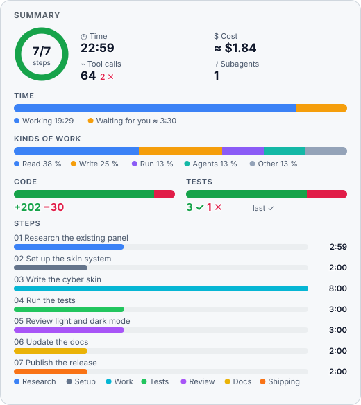

<p align="center">
  
</p>

<p align="center">
  <a href="https://github.com/thatkidluke/agent-cubes/releases/latest"></a>
  <a href="https://github.com/thatkidluke/agent-cubes/actions/workflows/check.yml"></a>
  <a href="LICENSE"></a>
  
</p>

<p align="center">
  <b>A live cube timeline of your agents' work, right beside the Claude Code chat.</b><br>
  Every step of the plan becomes a glass cube that fills while the agents work on it.
</p>

<p align="center">
  <a href="#install">Install</a> ·
  <a href="#the-panel">The panel</a> ·
  <a href="#skins">Skins</a> ·
  <a href="#settings">Settings</a> ·
  <a href="#how-exact-are-the-numbers">Accuracy</a> ·
  <a href="#privacy-and-permissions">Privacy</a>
</p>

---

## Install

In a Claude Code session:

```text
/plugin install agent-cubes --marketplace thatkidluke/agent-cubes
```

Or from a shell:

```bash
claude plugin install agent-cubes --marketplace thatkidluke/agent-cubes
```

In the desktop app: click **+** next to the prompt box → **Plugins** → **Add marketplace** with
`thatkidluke/agent-cubes` → **Add plugin** for Agent Cubes.

The panel opens when a session starts, or any time with `/cubes`.

## How it works

<p align="center"></p>

Every step of the agents' plan (`update_plan`, `TodoWrite`, `TaskCreate` / `TaskUpdate`) becomes a glass cube on a
timeline. While a step is worked on, its cube fills with small cubes, one slice of the step's real tool calls each,
tinted by the kind of work: reading, writing, running, agents. A finished step turns into a solid cube with a tick.

Subagents show up as coloured badges on the cube they work on. The panel estimates progress and time left, spots
steps that are stuck, and shows how full the context window is.

## The panel

<picture>
  <source media="(prefers-color-scheme: dark)" srcset="docs/panel-dark.svg">
  
</picture>

| | |
| --- | --- |
| **Overview** | Nine tiles, each with a pictogram that shows its figure: a clock for the time spent, an hourglass for the time left, a cup that fills while the agents wait for you, a glass cylinder for the context window, a warning sign, an activity chart of calls per minute, token bars, a stack of coins against your budget, and diff blocks for the lines changed. |
| **Now** | The step in work as a numbered badge, its progress and the agents on it. |
| **Agents** | The main agent and every subagent as an avatar, with the cube it works on and the tool it uses. A button each opens its transcript. |
| **Live** | The latest calls as a feed: an icon per kind of work, who made the call, what it touched and how it went. |
| **Cube details** | Time, tokens, cost share, lines changed, test runs, files and recent calls of one step. Keys **1–9** open the first nine. |

Everything follows the app's light or dark mode.

### When a task is done

<picture>
  <source media="(prefers-color-scheme: dark)" srcset="docs/summary-dark.svg">
  
</picture>

A ring for the steps done next to time, cost, tool calls and subagents; bars for working versus waiting and
for the kinds of work; code and tests; one bar per step, as long as it took and tinted by its kind. One click
copies it as Markdown, ready for a pull request.

## Features

<table>
<tr>
<td width="50%" valign="top">

**See what happens**

- Cube timeline with a status per step: open, running, done, waiting for you, error, each with its own symbol
- A progress pipe in its own band of the pedestal, filled with energy, liquid or pixels to suit the skin
- Subagents as badges on the cube they work on
- Live feed of the latest tool calls
- Context tank on the pedestal: amber from 70 %, red from 85 %
- Dependencies between tasks as pipes, a padlock on the waiting cube

</td>
<td width="50%" valign="top">

**Know where you stand**

- Progress and time left, learned per kind of step from this task and earlier ones
- Stuck detection: failures in a row, the same call over and over, long silence, far slower than usual
- Waiting time: how long the agents waited for you
- Cost per task with an optional budget
- Statistics across your last twelve tasks

</td>
</tr>
<tr>
<td width="50%" valign="top">

**Make it yours**

- Eight skins, from calm to playful
- Compact mode for long plans, still mode without animation
- English and German interface

</td>
<td width="50%" valign="top">

**Take it with you**

- Summary as Markdown with one click
- Export of the cube timeline as an SVG file
- Data export of the history as CSV and JSON

</td>
</tr>
</table>

## Skins

Pick a skin from the dropdown at the top of the panel.

<table>
<tr>
<td width="50%"><br><b>Classic</b> · stone pedestal, glass cubes and silver mini cubes</td>
<td width="50%"><br><b>Cyber</b> · neon console with circuit traces and holographic cubes</td>
</tr>
<tr>
<td><br><b>Cyberpunk</b> · a city at night, thin neon lettering, lights mirrored in a wet street</td>
<td><br><b>Stellar</b> · energy cubes in a star field on an obsidian pedestal</td>
</tr>
<tr>
<td><br><b>Retro</b> · an arcade cabinet at night: pixel art in phosphor colours, a soft CRT glow</td>
<td><br><b>Steampunk</b> · a Victorian instrument case of walnut and brushed brass</td>
</tr>
<tr>
<td><br><b>Robot factory</b> · a production hall of graphite steel, robot arms and coolant lines</td>
<td><br><b>Minimal</b> · flat and calm, for small panels</td>
</tr>
</table>

## Settings

Find them under **Agent Cubes** in the plugin settings; a change applies at once.

| Setting | Default | What it does |
| --- | --- | --- |
| `language` | `en` | Panel language: `en` or `de`. |
| `defaultSkin` | `classic` | The skin while none is picked in the panel; a pick in the panel wins. |
| `budgetUsd` | `0` | Cost budget per task in USD: amber from 80 %, a warning once passed. `0` turns it off. |
| `autoOpen` | on | Open the panel when a session starts; otherwise only via `/cubes`. |
| `animations` | on | Animation in the panel and the export; off draws still pictures. |
| `gaugeRow` | off | A row of glass canisters above the overview; the tiles show the same values. |
| `stuckSilentMinutes` | `5` | Minutes without a tool call after which a cube counts as stuck (0.5–240). |
| `stuckFailsInRow` | `3` | Failed calls in a row after which a cube is stuck (1–50). |
| `stuckSlowFactor` | `3` | How many times longer than a usual step, at least 8 minutes (1.1–50). |

## How exact are the numbers?

Progress, time left and cost are **estimates**.

- A step in work fills by its time and calls compared with finished steps of the same kind, or, until there are
  some, with earlier tasks. It only becomes full once it is checked off.
- A task's cost is the session's cost since the task began, shared out across its steps by their price-weighted
  tokens. Where the session reports no cost, the panel shows "–".
- The waiting time is exact for questions. For a permission prompt it runs until the approved call has finished,
  since the app does not report the moment of approval.

Only your account's figures are binding.

## Privacy and permissions

Agent Cubes only watches. It never changes, answers or blocks anything the agents do, and it sends nothing off
your machine: no network calls, no telemetry, no accounts. The only web address in the code is the SVG namespace
`http://www.w3.org/2000/svg`, which every SVG file names and nothing ever contacts.

**What it reads.** The plan steps, the tool calls of the session and its subagents (tool name, the file or command
for the live feed, the lines an edit adds or removes, whether the call failed), token use, the session's cost and
how full the context window is. It reads no credentials, environment variables or files of yours.

**The hooks it uses, and what each does**

| Hook | What it does |
| --- | --- |
| `session.start` | Loads the stored history and skin pick, opens the panel if `autoOpen` is on, starts a once-a-second refresh while a task runs. |
| `command.run` for `/cubes` | Opens the panel. |
| `turn.start`, `turn.step`, `turn.complete` | Start and end a task, count each model request's tokens. They pass everything on unchanged. |
| `agent.spawn` | Reads a new subagent's description to name its badge. The spawn itself is unchanged. |
| `tool.check` | Notes when a call needs your permission, to measure how long the agents wait for you. It passes the decision on exactly as it came and never makes one. |
| `tool.call` | Notes each call's start, end and outcome to fill the cubes. The call and its result are unchanged. |
| `ui.render` | Draws the panel. |

**What it stores.** Your skin pick and a short history of your last twelve tasks (step titles, times, counts, cost)
in the plugin's own storage, for estimates and statistics.

**What it writes, and only when you press a button**

- **Save as image** writes `agent-cubes-<time>.svg` into the session's working folder.
- **Export data** writes `agent-cubes-history-<time>.csv` and `.json` there.
- **Copy as Markdown** puts the summary on your clipboard.
- **↗ agent** opens that agent's transcript in the app.

No file it writes is one that other tools run or read as settings.

## License

MIT, see [LICENSE](LICENSE). Changes are listed in [CHANGELOG.md](CHANGELOG.md).
