<p align="center">
  
</p>

<p align="center">
  <a href="https://github.com/thatkidluke/agent-cubes/releases/latest"></a>
  <a href="https://github.com/thatkidluke/agent-cubes/actions/workflows/check.yml"></a>
  <a href="LICENSE"></a>
  
</p>

<p align="center">
  <b>A live view of your agents' work, right beside the Claude Code chat.</b><br>
  Every step of the plan becomes a glass cube that fills while the agents work on it,<br>
  or a chip on a circuit board that lights up. Your choice.
</p>

<p align="center">
  <a href="#install">Install</a> ·
  <a href="#the-scene">The scene</a> ·
  <a href="#or-as-a-circuit-board">Circuit board</a> ·
  <a href="#the-panel">The panel</a> ·
  <a href="#skins">Skins</a> ·
  <a href="#settings">Settings</a> ·
  <a href="#how-exact-are-the-numbers">Accuracy</a> ·
  <a href="#privacy-and-permissions">Privacy</a>
</p>

---

## Install

In a Claude Code session:

```text
/plugin install agent-cubes --marketplace thatkidluke/agent-cubes
```

Or from a shell:

```bash
claude plugin install agent-cubes --marketplace thatkidluke/agent-cubes
```

In the desktop app: click **+** next to the prompt box → **Plugins** → **Add marketplace** with
`thatkidluke/agent-cubes` → **Add plugin** for Agent Cubes.

The panel opens when a session starts, or any time with `/cubes`.

## How it works

<p align="center"></p>

Every step of the agents' plan (`update_plan`, `TodoWrite`, `TaskCreate` / `TaskUpdate`) becomes a glass cube on a
pedestal, a chip on a circuit board, or a segment of the ring in the orbit view; a dropdown switches between them. While a step is worked on, its cube fills with small cubes, one slice of the step's real tool calls each,
tinted by the kind of work: reading, writing, running, agents. A finished step turns into a solid cube with a tick.

Subagents show up as coloured badges on the cube they work on. The panel estimates progress and time left, spots
steps that are stuck, shows how full the context window is and what it all costs, and sums the task up once it
is done.

## The scene

The drawing tells what happens before you read a number:

- **Cubes** fill with mini cubes as calls end; the newest drops in as its call finishes. A finished step fuses into a
  solid block, a light edge runs round it and its plaque flips like a split-flap sign.
- **The progress pipe** in its own band of the pedestal fills from the left for the whole task, with a coupling at
  every step. What flows in it suits the skin: glowing energy, a liquid with bubbles, pixel blocks or a flat fill.
- **The context tank** on the pedestal's side fills with the same liquid; amber from 70 %, red from 85 %.
- **Agents** are badges over their cube. The main agent flies over to the step it starts; a new subagent flies from
  the main agent's step to its own.
- **Mood lights:** a warm spot falls on a step that waits for you, a stuck step glows red with a faint red edge
  round the scene, and the light turns calm once every step is done.
- **Dependencies** run as pipes between the cubes, with a padlock on the waiting one that springs open when it is
  free.
- **Long plans** stand in two rows, the earlier steps raised at the back; past sixteen cubes, finished runs fold
  into stacks.
- **Light and dark:** the scene stands free on the pane, with no backdrop of its own, so it sits well in a light and in a dark app.

### Or as a circuit board

<p align="center"></p>

The **View** dropdown at the top of the panel switches between the cubes and a circuit board; your pick is
remembered, and the `defaultView` setting says where new sessions start.

- **Parts:** every step is a part, its kind chosen by the kind of step: a processor for work, memory for research,
  a test IC, a lens for review, a labelled ROM for docs, a regulator for setup, a port for shipping. Steps expected to
  take longer get a larger part. The step's name stands under it in silkscreen.
- **LEDs:** a row lights up with the step's calls, one colour per kind of work; the newest flickers on as its call ends.
- **Traces:** copper joins the parts in order and winds from row to row. It glows once a step is done, pulses run
  into the part in work, and a wave of light runs over the whole board when the task is finished.
- **Dependencies:** a thin amber trace runs from the step waited for to the one that waits, with a diode on the
  waiting part that turns green when it is free.
- **Agents** sit on their part as probes and travel along the trace when they move on.
- **Signals:** a blinking push button on a part that waits for you, smoke and a red frame on one that is stuck, a red
  count for failed calls, a tag for the last test run.
- **Display:** the whole task in LEDs, a scope of the calls per minute, the parts done, the context window, cost
  and time left.
- **Solder masks:** green, black and gold, blue, white or red, from the **Board** dropdown.

<table>
<tr>
<td width="50%"><br><b>Green</b> · the classic</td>
<td width="50%"><br><b>Black and gold</b> · matte black, gold traces</td>
</tr>
<tr>
<td><br><b>Blue</b> · deep blue, light traces</td>
<td><br><b>White</b> · a light board for light rooms</td>
</tr>
<tr>
<td><br><b>Red</b> · dark red, warm traces</td>
<td>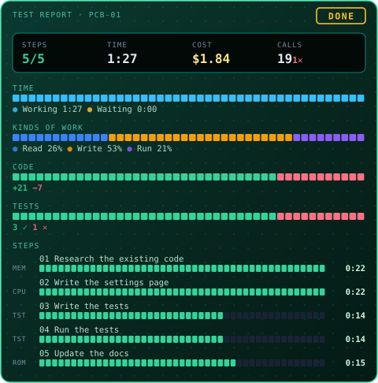<br><b>Test report</b> · the summary of a finished task, in the board's style</td>
</tr>
</table>

When the task is done, the summary turns into this test report. The widget shows a tiny board.

### Or as an orbit

<p align="center"></p>

The third view puts the agents first. The main agent is the sun in the middle, with the plan as a ring of segments
around it, one per step, and the progress written on it. Its latest calls circle it as a comet, a dot per call in
the colour of its kind of work. Every subagent is a planet on an orbit of its own: it travels while it works, with a
moon in the colour of what it is doing, and docks at the front once it is done. When the last step is done, the
ring lights up segment by segment and a wave runs outwards. The widget shows the sun and the ring.

## The panel

<picture>
  <source media="(prefers-color-scheme: dark)" srcset="docs/panel-dark.svg">
  
</picture>

| | |
| --- | --- |
| **Overview** | Nine tiles, each with a pictogram that shows its figure: a clock for the time spent, an hourglass for the time left, a cup that fills while the agents wait for you, a glass cylinder for the context window, a warning sign, an activity chart of calls per minute, token bars, a stack of coins against your budget, and diff blocks for the lines changed. |
| **Now** | The step in work as a numbered badge, its progress and the agents on it. |
| **Agents** | The main agent and every subagent as an avatar, with the cube it works on and the tool it uses. A button each opens its transcript. |
| **Live** | The latest calls as a feed: an icon per kind of work, who made the call, what it touched and how it went. |
| **Timeline** | The task as a band of time: a stroke per call in the colour of its kind of work, as wide as it took, the main agent above and the subagents below. Gaps are the agent thinking, amber is waiting for you, and a strip underneath says which step was in work. |
| **Files** | A tile per file the calls named, grouped by folder: wider the busier the file was, amber where it was written, blue where it was only read, with the lines changed or the number of reads. |
| **Cube details** | Time, tokens, cost share, lines changed, test runs, files and recent calls of one step. Keys **1–9** open the first nine. |

Everything follows the app's light or dark mode.

### When a task is done

With the cubes as the view:

<picture>
  <source media="(prefers-color-scheme: dark)" srcset="docs/summary-dark.svg">
  
</picture>

A ring for the steps done next to time, cost, tool calls and subagents; bars for working versus waiting and
for the kinds of work; code and tests; one bar per step, as long as it took and tinted by its kind. One click
copies it as Markdown, ready for a pull request. With the circuit board as the view, the same figures come as a
test report on a piece of the board.

## Features

<table>
<tr>
<td width="50%" valign="top">

**See what happens**

- A cube or a chip per step with a status: open, running, done, waiting for you, error, each with its own symbol
- A progress pipe and a context tank, filled to suit the skin
- Mood lights for waiting, stuck and finished steps
- Agents as badges that move with their work; a live feed of the latest calls
- Dependencies as pipes, with padlocks that spring open
- Two rows for long plans

</td>
<td width="50%" valign="top">

**Know where you stand**

- Progress and time left, learned per kind of step from this task and earlier ones
- Stuck detection: failures in a row, the same call over and over, long silence, far slower than usual
- Waiting time: how long the agents waited for you
- Cost per task with an optional budget
- Statistics across your last twelve tasks

</td>
</tr>
<tr>
<td width="50%" valign="top">

**Make it yours**

- Three views of the same task: cubes on a pedestal, chips on a circuit board, or an orbit of agents
- Eight skins for the cubes, from calm to playful, each standing free on the pane
- Five solder masks for the board
- Still mode without animation, for calm or slow machines
- English and German interface

</td>
<td width="50%" valign="top">

**Take it with you**

- Summary as Markdown with one click
- Export of the drawing, cubes or board, as an SVG file
- Data export of the history as CSV and JSON

</td>
</tr>
</table>

## Skins

The skins dress the cubes; the circuit board has [solder masks](#or-as-a-circuit-board) instead. Pick a skin from the dropdown at the top of the panel. Each brings its own pedestal, cubes and pipe filling,
and stands free on the pane, without a backdrop.

<table>
<tr>
<td width="50%"><br><b>Classic</b> · stone pedestal, glass cubes and silver mini cubes</td>
<td width="50%"><br><b>Cyber</b> · neon console with circuit traces and holographic cubes</td>
</tr>
<tr>
<td><br><b>Cyberpunk</b> · neon cubes on a dark block, lights mirrored in a wet street</td>
<td><br><b>Stellar</b> · energy cubes on an obsidian pedestal strewn with constellations</td>
</tr>
<tr>
<td><br><b>Retro</b> · an arcade cabinet: pixel art in phosphor colours</td>
<td><br><b>Steampunk</b> · a Victorian instrument case of walnut and brushed brass</td>
</tr>
<tr>
<td><br><b>Robot factory</b> · a machine of graphite steel with a robot arm and coolant lines</td>
<td><br><b>Minimal</b> · flat and calm, for small panels</td>
</tr>
</table>

## Settings

Find them under **Agent Cubes** in the plugin settings; a change applies at once.

| Setting | Default | What it does |
| --- | --- | --- |
| `language` | `en` | Panel language: `en` or `de`. |
| `defaultSkin` | `classic` | The skin while none is picked in the panel; a pick in the panel wins. |
| `defaultView` | `cubes` | The view while none is picked in the panel: `cubes`, `board` or `orbit`. |
| `budgetUsd` | `0` | Cost budget per task in USD: amber from 80 %, a warning once passed. `0` turns it off. |
| `autoOpen` | on | Open the panel when a session starts; otherwise only via `/cubes`. |
| `animations` | on | Animation in the panel and the export: filling, flights, mood lights, the pipe's flow. Off draws still pictures. |
| `gaugeRow` | off | A row of glass canisters above the overview; the tiles show the same values. |
| `stuckSilentMinutes` | `5` | Minutes without a tool call after which a cube counts as stuck (0.5–240). |
| `stuckFailsInRow` | `3` | Failed calls in a row after which a cube is stuck (1–50). |
| `stuckSlowFactor` | `3` | How many times longer than a usual step, at least 8 minutes (1.1–50). |

## How exact are the numbers?

Progress, time left and cost are **estimates**.

- A step in work fills by its time and calls compared with finished steps of the same kind, or, until there are
  some, with earlier tasks. It only becomes full once it is checked off.
- A task's cost is the session's cost since the task began, shared out across its steps by their price-weighted
  tokens. Where the session reports no cost, the panel shows "–".
- The waiting time is exact for questions. For a permission prompt it runs until the approved call has finished,
  since the app does not report the moment of approval.

Only your account's figures are binding.

## Privacy and permissions

Agent Cubes only watches. It never changes, answers or blocks anything the agents do, and it sends nothing off
your machine: no network calls, no telemetry, no accounts. The only web address in the code is the SVG namespace
`http://www.w3.org/2000/svg`, which every SVG file names and nothing ever contacts.

**What it reads.** The plan steps, the tool calls of the session and its subagents (tool name, the file or command
for the live feed, the name of the file's folder for the file map, the lines an edit adds or removes, whether the call failed), token use, the session's cost and
how full the context window is. It reads no credentials, environment variables or files of yours.

**The hooks it uses, and what each does**

| Hook | What it does |
| --- | --- |
| `session.start` | Loads the stored history and skin pick, opens the panel if `autoOpen` is on, starts a once-a-second refresh while a task runs. |
| `command.run` for `/cubes` | Opens the panel. |
| `turn.start`, `turn.step`, `turn.complete` | Start and end a task, count each model request's tokens. They pass everything on unchanged. |
| `agent.spawn` | Reads a new subagent's description to name its badge and notes when it started, for its flight to its step. The spawn itself is unchanged. |
| `tool.check` | Notes when a call needs your permission, to measure how long the agents wait for you. It passes the decision on exactly as it came and never makes one. |
| `tool.call` | Notes each call's start, end and outcome to fill the cubes. The call and its result are unchanged. |
| `ui.render` | Draws the panel. |

**What it stores.** Your picks of view, skin and solder mask, and a short history of your last twelve tasks (step titles, times, counts, cost)
in the plugin's own storage, for estimates and statistics.

**What it writes, and only when you press a button**

- **Save as image** writes `agent-cubes-<time>.svg` into the session's working folder.
- **Export data** writes `agent-cubes-history-<time>.csv` and `.json` there.
- **Copy as Markdown** puts the summary on your clipboard.
- **↗ agent** opens that agent's transcript in the app.

No file it writes is one that other tools run or read as settings.

## License

MIT, see [LICENSE](LICENSE). Changes are listed in [CHANGELOG.md](CHANGELOG.md).
